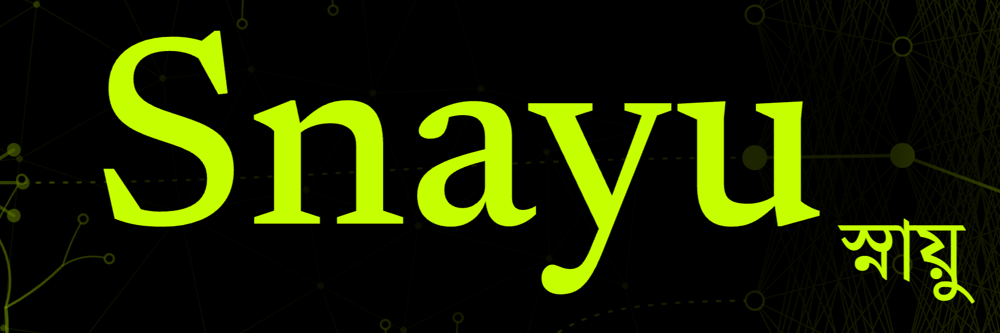

<p align="center">
  
</p>


<p align="center">
  <a href="https://www.youtube.com/@TheUnemployedEng">
    
  </a>
</p>

**A tiny neural network library built from scratch with nothing but NumPy.**

*Snayu (স্নায়ু) means "nerve" in Bengali.* This project exists to answer one question: $\color{red}{\textbf{what is actually happening inside a neural network?}}$ There's no PyTorch or TensorFlow here and no autograd magic. Every forward pass, every gradient and every weight update is written out by hand, so you can read it, change it and break it.


*Above: a network built with Snayu slowly learning a 3D surface (left is the target, right is the network's guess). It starts as a blob and ends up nearly identical. See [`Examples/universal_approximator.ipynb`](Examples/universal_approximator.ipynb).*

---

## ✨ What's inside

| Piece | What you get |
|---|---|
| **Layers** | `DenseLayer`, `ActivationLayer`, `DropoutLayer`, `SoftmaxLayer` |
| **Activations** | `Sigmoid`, `ReLU`, `LeakyReLU`, `Tanh` |
| **Losses** | `MSE`, `MAE`, `BinaryCrossEntropy`, `CategoricalCrossEntropy` |
| **Training** | `train()` with a progress log and an auto-plotted loss and accuracy chart |
| **Inference** | `predict()` runs data through the network |

---

## 📺 Video series

Prefer to learn by watching? The [Snayu video series on YouTube](https://www.youtube.com/@TheUnemployedEng) walks through this project, so you can follow along with the code in this repo.

---

## 🚀 Quick start

### 1. Get set up

You need Python 3.9+ (the project was built on 3.11).

```bash
git clone https://github.com/TheUnemployedEngineer/Snayu
cd Snayu

python -m venv .env
.env\Scripts\activate          # Windows
# source .env/bin/activate     # macOS / Linux

pip install numpy matplotlib
pip install jupyter pillow     # only needed for the notebook example
```

### 2. Teach a network XOR

XOR is the classic "hello world" of neural networks. A single neuron can't solve it, but a small network can.

```bash
python -m Examples.xor
```

> Run it **from the project root** with `-m`, as shown above. That's what lets Python find the `Layer`, `Functions` and `Network` folders.

You'll see the loss fall and then a prediction for each input:

```
Epoch 3000/3000  loss: 0.0133  accuracy: 1.0000
input: [0, 0] -> pred: 0 (0.0xxx) | target: 0
input: [0, 1] -> pred: 1 (0.9xxx) | target: 1
input: [1, 0] -> pred: 1 (0.9xxx) | target: 1
input: [1, 1] -> pred: 0 (0.0xxx) | target: 0
```


---

## 🧩 Build your own network

A network in Snayu is just **a Python list of layers**. Data flows through the list from left to right, and gradients flow back from right to left.

```python
import numpy as np
from Layer.DenseLayer import DenseLayer
from Functions.ActivationFunctions import ReLU, Sigmoid
from Functions.LossFunctions import BinaryCrossEntropy
from Network.train import train
from Network.predict import predict

network = [
    DenseLayer(2, 8),   # 2 inputs -> 8 neurons
    ReLU(),
    DenseLayer(8, 1),   # 8 neurons -> 1 output
    Sigmoid(),
]

history = train(
    network, BinaryCrossEntropy(), X, Y,
    epochs=1000, learning_rate=0.05,
)

prediction = predict(network, X[0])
```

### 📐 One rule about data shape

Snayu works with **column vectors**, one sample at a time:

- each input has shape `(features, 1)`
- each target has shape `(outputs, 1)`
- a dataset is a stack of those, so `X` has shape `(num_samples, features, 1)`

```python
X = np.reshape([[0, 0], [0, 1], [1, 0], [1, 1]], (4, 2, 1))
Y = np.reshape([0, 1, 1, 0], (4, 1, 1))
```

### 🏷️ Multi-class classification

Finish the network with `SoftmaxLayer` and train it with `CategoricalCrossEntropy`. Use one-hot targets of shape `(classes, 1)`.

```python
network = [
    DenseLayer(4, 16), Tanh(),
    DenseLayer(16, 3),
    SoftmaxLayer(),
]
loss = CategoricalCrossEntropy()
```

### 🎲 Regularization

Add `DropoutLayer(rate=0.3)` between layers. `train()` switches it on during training and off during prediction for you.

---

## 🔬 Showcase: a universal function approximator

[`Examples/universal_approximator.ipynb`](Examples/universal_approximator.ipynb) puts the library to a harder test. It trains a `2 → 64 → 64 → 32 → 1` Tanh network to reproduce a bumpy 3D surface, and renders the learning process as the animation at the top of this page.

It's a hands-on demo of the **universal approximation theorem**: given enough neurons, a network can learn almost any smooth function. Open the notebook, swap in your own `f(x, y)`, and watch it learn.

---

## 📁 Project layout

```
Snayu/
├── Layer/                  # the building blocks
│   ├── BaseLayer.py        #   abstract Layer: forward() + backward()
│   ├── DenseLayer.py       #   fully-connected layer (weights + biases)
│   ├── ActivationLayer.py  #   applies an activation function element-wise
│   ├── DropoutLayer.py     #   randomly silences neurons while training
│   ├── SoftmaxLayer.py     #   turns scores into probabilities
│   └── LossLayer.py        #   wraps a loss function and its derivative
├── Functions/
│   ├── ActivationFunctions.py   # Sigmoid, ReLU, LeakyReLU, Tanh
│   └── LossFunctions.py         # MSE, MAE, BCE, CCE
├── Network/
│   ├── train.py            # the training loop (forward, loss, backprop, update)
│   ├── predict.py          # pushes an input through every layer
│   └── utils.py            # accuracy check + the training-history plot
└── Examples/
    ├── xor.py                        # the classic starter problem
    ├── universal_approximator.ipynb  # learn a 3D surface, with animation
    └── universal_approximator.gif    # the animation from the notebook
```

---

## 🛠️ How it works

Every layer follows the same two-method contract (see [`BaseLayer.py`](Layer/BaseLayer.py)):

```python
class Layer:
    def forward(self, inputs): ...                    # compute the output
    def backward(self, grad_output, learning_rate): ... # pass the gradient back (and learn)
```

Training one sample goes like this:

1. **Forward**: `predict()` pushes the input through every layer.
2. **Loss**: the loss layer compares the prediction with the target.
3. **Backward**: the gradient travels through the layers in reverse. Each `DenseLayer` updates its own weights as the gradient passes through.
4. Repeat for every sample, every epoch.

That's it. Training is **stochastic gradient descent, one sample at a time**. It's simple to read, but not built for speed.

### ➕ Adding your own activation or loss

An activation is just a function and its derivative. Here's a whole new one:

```python
import numpy as np
from Layer.ActivationLayer import ActivationLayer

class Softplus(ActivationLayer):
    def __init__(self):
        super().__init__(
            lambda x: np.log(1 + np.exp(x)),     # f(x)
            lambda x: 1 / (1 + np.exp(-x)),      # f'(x)
        )
```

Losses work the same way through `LossLayer(loss, loss_prime)`.

---

## ⚠️ Good to know

- **Learning tool, not a production framework.** No batching, no GPU, no optimizers beyond plain gradient descent, so it's slow on big data.
- **Weights start random**, so results vary from run to run. Call `np.random.seed(42)` for reproducible runs.
- **Pick a sensible learning rate.** If the loss explodes or stays flat, change it first.
- `train()` opens a matplotlib window at the end. Pass `plot=False` to skip it.

---

## 🗺️ Ideas for what to build next

- Mini-batch training
- Optimizers such as Momentum and Adam
- Convolution and pooling layers
- Saving and loading trained weights
- More examples, such as MNIST digits

---

## 🤝 Contributing

Found a bug or have an idea? Open an issue or a pull request. Clear, readable code is the goal here, so keep it simple.

Happy learning! 🌱
